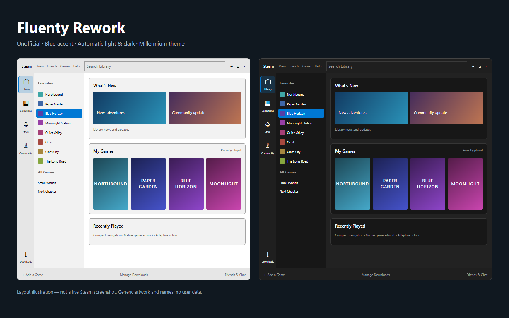

# Fluenty Rework (Unofficial)

A compact Fluent-inspired theme for Steam with Millennium. Maintained by **Tomclanc**. This is an independent, unofficial adaptation, not the official or paid Fluenty theme.

> The preview is a layout illustration, not a live Steam screenshot. The theme is experimental and Steam updates can change selectors.

## Features

- Compact desktop navigation with Library, Collections, Store, Community and Downloads.
- Automatic, forced light and forced dark color schemes with a blue accent.
- Library shelves, game details, downloads, settings, friends and chat surfaces.
- Steam’s original library search is visually positioned in the title bar on wide windows and remains in the sidebar on narrow windows.
- English and Simplified Chinese navigation labels.
- Experimental Big Picture styling; controller behavior remains native.

## Install

Install Millennium first: https://steambrew.app/ . Download the latest release ZIP, extract its contents into a folder named Fluenty-Rework under <Steam>/millennium/themes/, select **Fluenty Rework** in Millennium, enable theme CSS/JavaScript, and fully restart Steam. Only one theme should be active.

Choose **Color Mode → Auto / Light / Dark** in the theme options. Personal CSS can go in custom.css, which loads last.

## Status and limitations

Version **0.7.6** is a public preview. Native-CSS browser fixtures cover palettes, selected navigation, settings labels and chat layout. Live Steam compatibility is still being refined. Big Picture support is experimental; Store/Community website content is not comprehensively reskinned. This release does not collect data or load remote theme code.

Theme JavaScript adds navigation elements; search uses the original Steam control, without event forwarding or moving React-owned elements. Sidebar links invoke Steam navigation or the native Steam URL protocol. Community access still depends on Steam/network availability.

## Credits and licensing

- Visual/layout inspiration: [Fluenty](https://steambrew.app/fluenty-steam) and [Hexality/Fluenty](https://github.com/Hexality/Fluenty).
- Neutral light/dark palette reference: [Zehn by yurisuika](https://github.com/yurisuika/Zehn).
- Historical visual reference: [purogamer/Fluent-for-Steam](https://github.com/purogamer/Fluent-for-Steam).

Public release CSS/JavaScript is independently authored. No upstream Zehn stylesheet, Fluenty paid source, executable, font or artwork is bundled. Earlier private development builds copied Zehn CSS; those files are excluded from this public repository. Color values and Steam selector names are implemented in a new local palette. See [SOURCES.md](SOURCES.md).

Original project code is provided under the [MIT License](LICENSE). Steam, Millennium, Fluenty and Zehn names belong to their respective owners. No affiliation or endorsement is claimed.

## 中文

非官方 Fluent 风格适配主题：紧凑侧栏、蓝色强调色、自动/强制深浅色，覆盖库、详情、下载、设置、好友与聊天。大屏模式仍属实验功能。安装后完整重启 Steam；颜色模式在主题设置中选择。公开版使用独立编写的配色实现，不包含开发阶段复制的 Zehn 源码。遇到问题请附 Steam/Millennium 版本、颜色模式及已去除隐私信息的截图。

## Changes in 0.7.6

- Native library search replaces the input proxy, preserving IME composition and focus. Search uses one border and stays in the sidebar on narrow windows.
- Light/dark colors cover detached chat tabs, friends headers, invite/voice controls, library Home/Collections icons and the return-to-top arrow. Native voice/error states remain visible.
- The account menu uses a circular avatar, with text fallback when no avatar is available. Native menu behavior is retained.
- CSS-only login patches cover Chromium login forms and verification surfaces. The earliest native updater/bootstrap window remains outside Millennium theme CSS.

Validation uses native Steam CSS browser fixtures, including asynchronous component styles. These checks are not a substitute for live compatibility across Steam versions. Fully restart Steam after updating to unload the old search proxy.
